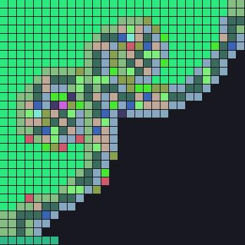

# Lands of Lore II: file formats and game rules

*Lands of Lore: Guardians of Destiny* is a first-person role-playing game by Westwood Studios (1997). This repository documents how its original data files and rules work, and gives you Python tools that read them from your own copy of the game.

It contains documentation, tools and small tables of numbers. It contains no game files and no extracted game pictures, sounds, movies or text dumps.



*A room layout from `LOCAL.MIX` entry 1, drawn from its tile numbers (`tools/lol2_decompress_sphere.py 11 --png out.png`): one colour per tile number, not the game's graphics.*

## What you get

- **Format and engine pages** in [`docs/`](docs): archives, level scripts, level geometry, walls and textures, items, sound, music and movies. One page per format with worked examples is being written (see [STATUS](docs/STATUS.md)).
- **Tools** in [`tools/`](tools/README.md): archive reader, name hashing, decompressors, entity and level analysers, audio and video decoders, and the wall/geometry pipeline in `tools/draracle/`.
- **[Start here, by goal](docs/START_HERE.md)**, a **[glossary](docs/GLOSSARY.md)** and the **[open questions](docs/OPEN_QUESTIONS.md)**.

## Quick start

You need Python 3.8+ and your own copy of the game.

```bash
git clone https://github.com/KForestland/lands-of-lore-2-re.git
cd lands-of-lore-2-re
python3 -m venv .venv && . .venv/bin/activate
pip install -r requirements.txt
export LOL2_DAT=/path/to/your/LOL2/DAT          # the game's DAT folder
python3 tools/check_all.py                      # 11 checks, ends with ALL 11 CHECKS PASSED
python3 tools/lol2_mix_parser.py L1_DC.MIX      # list the entries of level 1's archive
```

## Status

Full table with evidence: [`docs/STATUS.md`](docs/STATUS.md).

| Area | State |
|------|-------|
| Archives (MIX), entry names, compression | Documented in part; readers check all 81 archives |
| Levels, geometry, walls, textures | Documented for the traced parts; geometry entry found in all 15 levels; wall spans and UVs partly open (Q16) |
| Level scripts | Format and many opcodes documented; full opcode table open (Q4) |
| Entities, items, combat | Record layouts documented; item grants and effects, combat beyond one encounter open (Q8, Q10) |
| Sound, music, movies | AUD bank, music archive and VQA v2 decoded; HMI music and the movie control table open (Q12, Q15) |
| Globals, timers, spells, text, saves | Not yet documented here (Q6, Q7, Q9, Q11, Q13) |

## Repository layout

- [`docs/`](docs): format and engine pages, status, open questions, glossary; older closure notes kept as history
- [`tools/`](tools/README.md): readers and analysers
- [`evidence/`](evidence): trace references and evidence indexes from earlier work
- [`data/`](data): machine-readable inventory summaries
- [`examples/`](examples/README.md): small images made by the tools

## Asset policy

No game files and no dumps of extracted game media are included; short byte excerpts appear in the documentation as examples. `tools/check_all.py` includes `repo_guard.py`, which fails if a game file, media file or stray image is committed. To run the tools you need your own copy of the game.

## Sources

Facts are checked against the original files and the original program (`LOLG.DAT`), with addresses or file offsets cited on each page. This is independent documentation.
