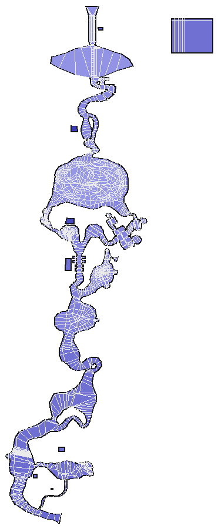

# Follow LoL2 L1_DC from map to exit

Use the first cave archive to connect a floor plan to its map data, exit commands and creature definitions.



## Draw the floor plan and write the sheet

```bash
export LOL2_DAT=/path/to/your/LoL2/DAT
mkdir -p ../lol2-tour
python3 tools/lol2_level_map.py --level 1 --size 900 --out ../lol2-tour/l1_dc_regions.png
python3 tools/lol2_level_report.py --level 1 --out ../lol2-tour
```

**CONFIRMED.** The map entry starts at `L1_DC.MIX+0x6C370A`. Its header +0x04 locates the vertices and +0x0C locates the regions. The picture shades the 1,954 region polygons by floor height, darker for higher floors. Regions with overlapping storeys share the same view from above. The sheet also gives the texture bank and object-definition entry offsets. [Geometry and objects](levels/L1_DC.md#geometry-and-objects) · [Native level loader](HOW_A_LEVEL_IS_PUT_TOGETHER.md)

## Follow one exit to L3_DH

```bash
python3 tools/lol2_event_browser.py L1_DC --stream 0 --group 0x4AA
python3 tools/lol2_progression.py --out ../lol2-tour/progression.md
```

**CONFIRMED.** For stream-0 group `0x4AA`, the trigger at `L1_DC.MIX+0x6FDC4B` is region 1190 receiving event 2. Its predicate 179 at `+0x70653C` has bytes `00 03 02 00 05` and tests local slot 2 for value 5. When that row runs, the command at `+0x6FD59F` requests L3_DH, arrival 1. The other eight region rows for this destination test the same slot. **UNCONFIRMED.** The separate prop row at group 4030 names an exit with an upstream trigger. Trace the callers of the kind-8 matcher at `0xAE510` and its arguments to find the sender. [L1_DC exit rows](PROGRESSION.md#level-l1_dc) · [Event and predicate readers](lol2-script-events.md)

## Read the creature numbers

```bash
python3 tools/lol2_numbers.py --out ../lol2-tour/numbers.md
```

**CONFIRMED.** The map header +0x1C/+0x68 supplies the actor placement table. The sheet counts 57 actor placements and 11 definition rows in the ODF, with repeat tags among those rows. ODF slot 0 at `L1_DC.MIX+0x712D9B` is tagged `GGCAPT`. The u16 at row +0x63 gives HP cap 100, and byte +0x81 gives attack input 6. The attack code turns that input into `max(1, 6/10)` = 1 by integer division (the Attack floor column); profile, live mode and frame percentage then affect damage. The placement count and the definition count describe different tables. [Level sheet](levels/L1_DC.md#entity-records) · [Stored creature stats](NUMBERS.md#creature-numbers-by-level) · [Native attack calculation](lol2-combat-ai.md#creature-state-and-attack-output)
