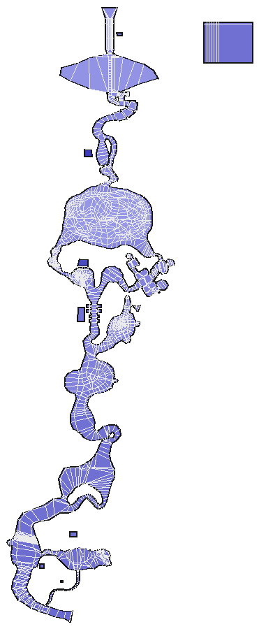

# Level maps

**What:** a level's map follows from its [geometry](geometry.md): each region is a four-sided polygon over the vertex table, and its neighbour words say which sides are walls and which are open. `tools/lol2_level_map.py` draws this as a top-down picture, with north up:
- each region is filled with a shade of its floor height (darker = higher);
- wall sides are dark lines;
- portal sides are light lines.

The picture is a plot of numbers from the level data entry and contains no game pixels.

```bash
python3 tools/lol2_level_map.py --data <DAT> --level 1 --out l1_map.png
python3 tools/lol2_level_map.py --check --data <DAT>
```

**CONFIRMED** (re-run 2026-11-18): the 15 levels hold 52,669 region polygons, and each one has four distinct corners inside the vertex table.

## Worked example



*L1_DC: 1,954 regions with floor heights from −1000 to 580. The level runs as one long cave from south to north.*

Following the portal links splits L1_DC into 9 groups that no portal connects:
- the main cave, 1,933 regions;
- the square at the top right, 14 regions, whose interior lines are portals between its own regions;
- 7 single regions, the small dark blocks.

How the game reaches the separate groups is not traced. The [level sheet](../levels/L1_DC.md) lists the exits and the objects that start them.

## Not covered

- **The game's own automap:** the data the game uses to draw its in-game map, and which regions it marks as seen, are not located (UNCONFIRMED).
- **Several floors over one spot:** levels with storeys, such as the Huline Temple and the Hive, overlap in a top-down picture. Separating them needs the drawer's portal rules ([Q16](../OPEN_QUESTIONS.md)).
