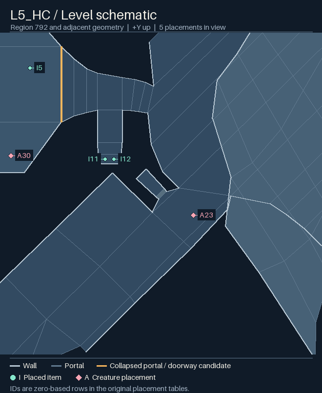

# Examples

## Level 5 schematic



```sh
python3 tools/lol2_level_schematic.py --data /path/to/DAT --level 5 --focus 792 --radius 360 --size 660 --out /tmp/l5_hc_schematic.png
```

Expected report `L5_HC: 5 placements, 0 crowded labels omitted; wrote /tmp/l5_hc_schematic.png`.

**CONFIRMED.** The amber segment comes from regions 801 and 1216
at `L5_HC.MIX+0x5986AF` and `+0x59CE03`. Region 801 begins with
floor and ceiling both −1700. The ceiling-motion command at `+0x5AEB61`
adds 100 to its height (see `0x64FBA–0x64FE3` and the
[motion reference](../docs/lol2-script-motion.md#opcode-196)). Marks
I5 and A23 come from `+0x5ABCAB` and `+0x5AB8E2`. Coordinate words
+0/+2 enter the common placement constructor `0xAE99A–0xAE9CB`.
The cyan outline is the selected region 792. Lighter floor fills are
higher floors; the region overview from `lol2_level_map.py` shades the
other way (darker = higher). Stacked storeys can overlap in plan view.
The image plots geometry and placement numbers. It contains no game pixels.

The [full region overview](../docs/formats/maps.md) comes from
`tools/lol2_level_map.py`. `tools/example_images.py --check` rebuilds
both tracked pictures and compares the pixels.

The game wall texture and the decoded tile images that used to be here were removed on 2026-11-18 (asset policy). `atlas_candidate_verify/` keeps its notes and JSON; the images it mentions are no longer in the repository.
